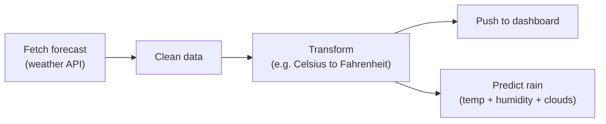
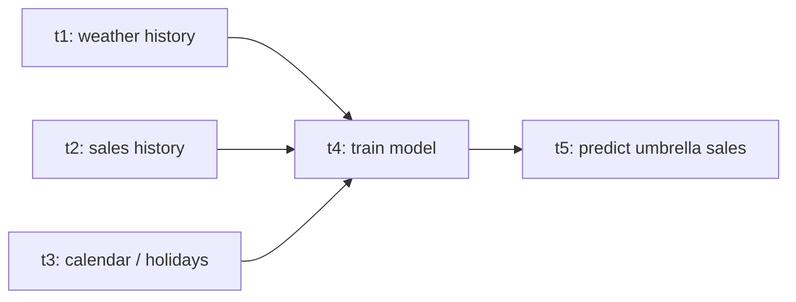
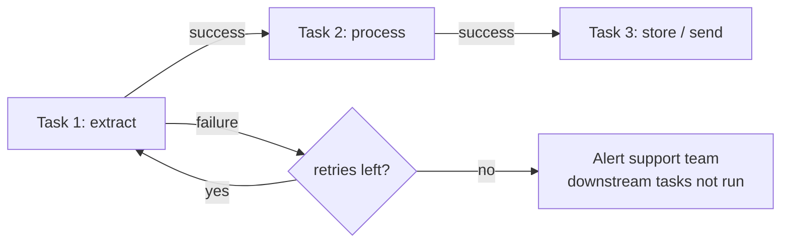

# 00 · Data pipelines, tasks & orchestration

---

## Part 1 — What is a data pipeline

A **data pipeline** = several tasks (actions) that must run, usually in a specific order, to produce a desired result.

Each task has a **code unit** behind it, and the technologies can be mixed:
- a Bash / shell script
- a Python script
- a SQL query, stored procedure or database function
- a call to a cloud service (BigQuery job, Dataflow job, API request)

### Example: a small weather dashboard



The arrows are **dependencies**: you can't clean data you haven't fetched, and there's no point pushing data that failed to transform.

### Example: tasks that can run in parallel

A more realistic case: five tasks of about 2 hours each.

- Run serially with cron, one after another, they take **10 hours**.
- But `t1`, `t2`, `t3` don't depend on each other, so they can start at the same time. `t4` needs all three; `t5` needs `t4`.



Now the critical path is `t1 -> t4 -> t5` = **6 hours**. A job that starts at midnight is ready by 6 AM.

### Typical use cases

| Use case | Example |
|---|---|
| **ETL / ELT** | Extract from an ERP, transform, load into a data warehouse |
| **ML pipelines** | Fetch features, train, evaluate, publish predictions |
| **Data delivery** | Export data and send it to an external partner / system |
| **Ops jobs** | Database backups, data exports, cleanups |
| **Anything recurring** | Any automated job that must run regularly and depends on other jobs or conditions |

---

## Part 2 — Tasks and orchestration

A **task** is one step of the pipeline (extract, process, store...). **Orchestration** is everything that happens *around* the tasks without a human:

- start a task only when its upstream tasks **succeeded**
- **retry** a failed task after a delay
- if it keeps failing, stop downstream tasks and **alert** someone (email, Slack, PagerDuty)
- keep **history**: when did it run, how long did it take, what did it log



> **Tip:** The orchestrator doesn't do the heavy lifting itself. It tells other things (scripts, databases, BigQuery, Spark) **what** to run and **when**, and watches the result.

---

## Part 3 — Why not just cron?

cron runs a command at a given time. That's it.

| Need | cron | Airflow |
|---|---|---|
| Run on a schedule | yes | yes |
| Dependencies between jobs | no (you guess with time gaps) | yes, explicit |
| Run independent jobs in parallel | manually | automatic |
| Retries with delay | no | `retries`, `retry_delay` |
| Skip downstream if upstream failed | no | default behaviour |
| Alerts on failure / lateness | no | callbacks, email, timeouts |
| History, logs, durations in a UI | no | yes |
| Re-run just the failed part | no | "Clear" a task in the UI |
| Backfill past dates | no | `airflow backfill` / catchup |

Example of the "re-run" advantage: a nightly job with 25 tasks fails at task 16 because of bad input data. Next morning you fix the data and **clear task 16**; Airflow re-runs 16 and everything after it, not tasks 1 to 15.

---

## Part 4 — What is Apache Airflow

- An **open source** platform to **author, schedule and monitor workflows**.
- Workflows are written **as Python code** (DAG files). You need decent Python, plus Linux / Bash basics, to be comfortable.
- A workflow is a **DAG** (Directed Acyclic Graph), see [01](../01-dags-operators/README.md).
- Created at Airbnb (2014), now an Apache top-level project.

### Ways to run it

| Option | What you manage | Good for |
|---|---|---|
| **Local install** (`pip install apache-airflow`, `airflow standalone`) | everything | learning, quick tests |
| **Docker Compose** (official `docker-compose.yaml`) | containers | local multi-component setup |
| **VM in any cloud** | OS, install, upgrades, DB | small self-hosted setups |
| **Kubernetes** (official Helm chart) | cluster + chart values | self-hosted at scale |
| **Managed**: Google **Cloud Composer**, AWS MWAA, Astronomer | only DAGs and config | production without ops work |

These notes use **Cloud Composer** for the cloud parts: you enable an API, create an environment, and upload DAGs into a GCS bucket. No installation. The trade-off is cost: an environment bills while it exists, even when idle, so delete it when you're done ([19](../19-composer-cleanup/README.md)).

> **Tip:** New GCP accounts get free trial credit (USD 300 for 90 days at the time of writing). A Composer environment can use a noticeable part of it per week, so create it when you study, delete it after.

---

## Cheat sheet

```text
Data pipeline  = tasks + dependencies that produce a result
Task           = one unit of work (bash, python, sql, cloud job)
Orchestration  = run in order, in parallel where possible, retry, alert, keep history
Airflow        = open source orchestrator, workflows as Python DAGs
Cloud Composer = managed Airflow on GCP (DAGs live in a GCS bucket)
```
