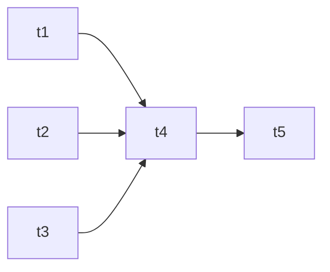
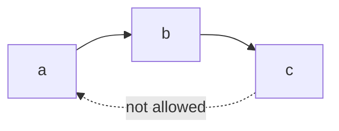

# 01 · DAGs & operators

---

## Part 1 — Directed Acyclic Graph

Every Airflow workflow is a **DAG**:

| Word | Meaning |
|---|---|
| **Graph** | nodes (tasks) connected by edges (dependencies) |
| **Directed** | edges have a direction: `a >> b` means "a before b" |
| **Acyclic** | no loops: you can never get back to a task you already passed |



Valid: `t1`, `t2`, `t3` are independent and run in parallel; `t4` waits for all three; `t5` waits for `t4`.



Invalid: `c -> a` would create a cycle. Airflow refuses to load such a DAG.

> **Warning:** "Acyclic" is about dependencies inside **one run**, not about repetition. A DAG can run every day (`schedule="@daily"`); each run is a new, independent DAG run. What you can't do is make the first task of a run depend on the last task of the same run.

### Vocabulary

| Term | Meaning |
|---|---|
| **DAG** | the workflow definition (a Python file) |
| **DAG run** | one execution of the DAG for a specific date / interval (`logical_date`) |
| **Task** | a node in the DAG |
| **Task instance** | one task in one DAG run, has a state: `scheduled`, `queued`, `running`, `success`, `failed`, `skipped`, `up_for_retry`, `upstream_failed`... |
| **Operator** | the template a task is built from (what kind of work it does) |

---

## Part 2 — Operators

A DAG is made of tasks, and each task is an **instance of an operator**. The operator decides *what* actually executes.

| Family | Examples | What it does |
|---|---|---|
| **Action operators** | `BashOperator`, `PythonOperator`, `EmailOperator`, `SSHOperator` | run something |
| **Transfer operators** | `BigQueryToGCSOperator`, `GCSToBigQueryOperator` | move data from A to B |
| **Cloud / service operators** | `BigQueryInsertJobOperator`, `DataprocSubmitJobOperator`, `KubernetesPodOperator` | start a job in another system |
| **Sensors** | `FileSensor`, `GCSObjectExistenceSensor`, `ExternalTaskSensor` | **wait** until a condition is true, see [16](../16-sensors/README.md) |
| **Flow control** | `EmptyOperator`, `BranchPythonOperator`, `ShortCircuitOperator` | structure, branching, no real work |

```python
from airflow.providers.standard.operators.bash import BashOperator
from airflow.providers.standard.operators.python import PythonOperator

say_bye = BashOperator(task_id="say_bye", bash_command="echo bye")
say_hi  = PythonOperator(task_id="say_hi", python_callable=lambda: print("hi"))
```

### Providers

Since Airflow 2, operators for external systems live in separately installed **provider packages**:

```bash
pip install apache-airflow-providers-google        # BigQuery, GCS, Dataproc, Composer...
pip install apache-airflow-providers-ssh
pip install apache-airflow-providers-cncf-kubernetes
```

In Airflow 3 even the basic `BashOperator` / `PythonOperator` moved to `apache-airflow-providers-standard` (installed with Airflow by default).

### TaskFlow API (decorators)

The modern way to write Python tasks. Same thing as `PythonOperator`, less boilerplate, and return values are passed between tasks automatically (see [11](../11-xcom/README.md)):

```python
from airflow.sdk import task

@task
def say_hi():
    print("hi")
```

> **Tip:** Rule of thumb: Python logic -> `@task`. Shell commands -> `BashOperator` (or `@task.bash`). Calling a cloud service -> that service's provider operator.

Where to find operators: the **Providers** section of the Airflow docs, and the Astronomer Registry, list every operator with its parameters.

---

## Cheat sheet

```python
a >> b             # a then b
[a, b, c] >> d     # d after a, b and c
a >> [b, c]        # fan out
from airflow.sdk import chain
chain(a, b, c, d)  # same as a >> b >> c >> d
```
