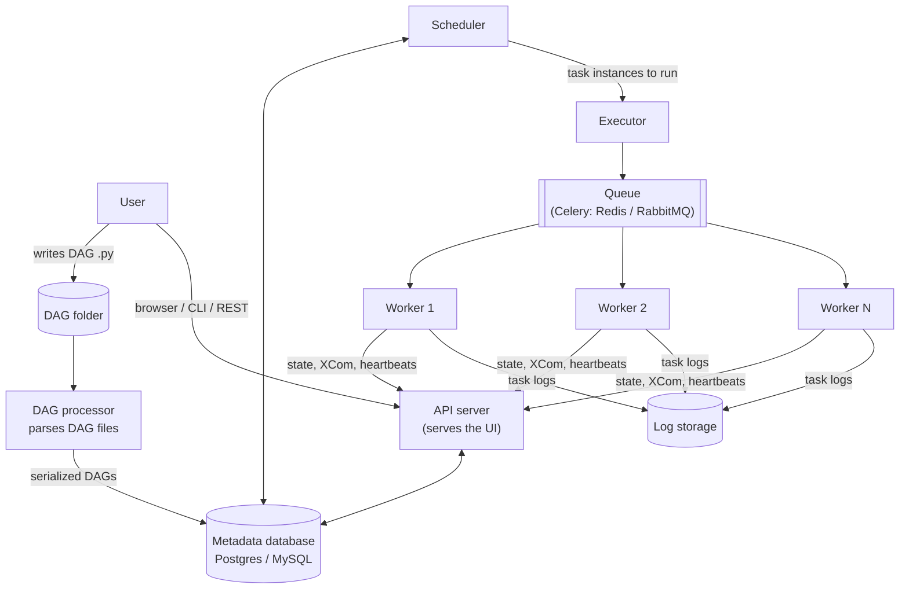
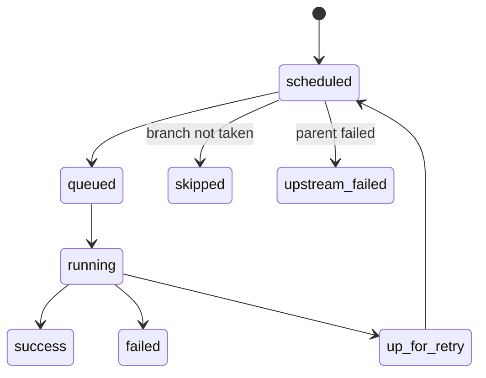
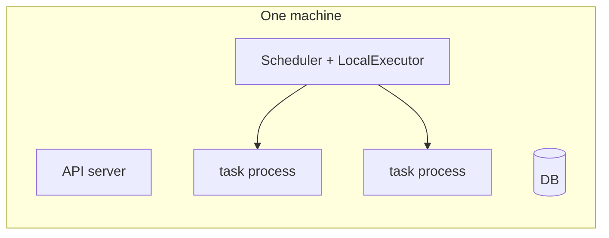
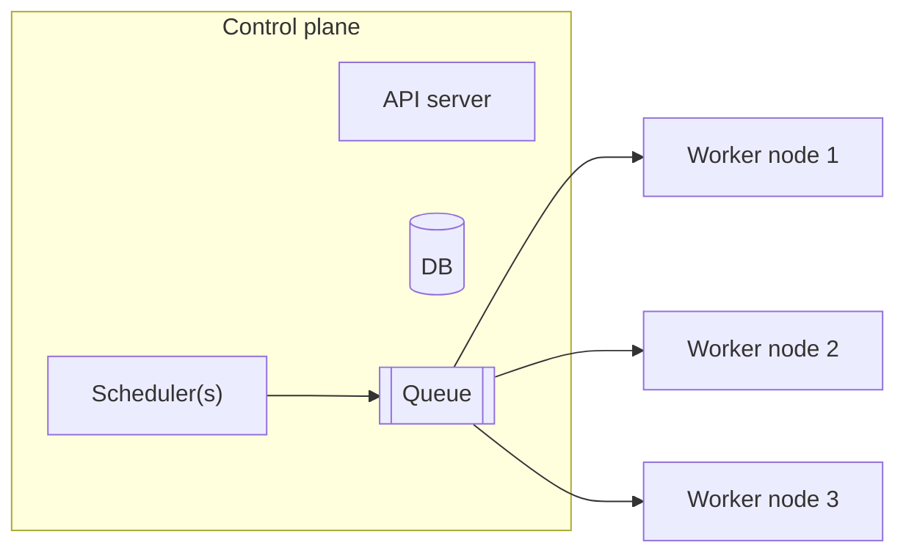

# 02 · Architecture

---

## Part 1 — Components



| Component | Job |
|---|---|
| **DAG folder** | where your `.py` files live (in Composer: the `dags/` folder of a GCS bucket) |
| **DAG processor** | keeps re-reading the DAG folder, parses files, stores the serialized DAGs in the DB |
| **Scheduler** | the heart: decides which DAG runs to create and which task instances are ready to run |
| **Executor** | decides *how / where* tasks run (in-process, on Celery workers, as Kubernetes pods). Runs inside the scheduler process |
| **Queue** | buffer between scheduler and workers (only for distributed executors like Celery) |
| **Workers** | actually execute the task code |
| **Metadata DB** | the source of truth: DAG runs, task states, Variables, Connections, XComs, users |
| **API server + UI** | the web UI you use to monitor, trigger, clear, and the REST API (`airflow api-server`) |
| **Triggerer** | runs *deferred* tasks (async sensors) cheaply, see [16](../16-sensors/README.md) |

> **Tip:** In Airflow 3 workers no longer connect to the metadata DB directly; they talk to the API server through the **Task Execution Interface**. That makes workers safer to run in remote / untrusted places.

### What the scheduler does in a loop

1. Read the parsed DAGs: tasks, dependencies, schedule.
2. For each DAG: has the next schedule interval arrived? If yes, create a **DAG run**.
3. For each running DAG run: which task instances have all upstream dependencies met (and pools/concurrency allow it)? Mark them **scheduled** and hand them to the executor (**queued**).
4. Workers pick them up (**running**), report **success / failed**.
5. Repeat.



---

## Part 2 — Executors

| Executor | Where tasks run | Use it for |
|---|---|---|
| `LocalExecutor` | subprocesses on the scheduler machine | learning, small setups, single node |
| `CeleryExecutor` | a pool of long-lived worker machines fed by a queue (Redis/RabbitMQ) | multi-node, steady load |
| `KubernetesExecutor` | one new pod per task on a Kubernetes cluster | isolation, bursty load, scale to zero |
| `CeleryKubernetesExecutor` / multiple executors | mix: per-task choice | heterogeneous workloads |

(`SequentialExecutor` was the old default with SQLite, one task at a time; it's gone in Airflow 3.)

---

## Part 3 — Single node vs multi-node

### Single node

All components (API server, scheduler, executor, workers, DB) on **one machine**, usually with `LocalExecutor`.



- easy to set up, cheap
- **single point of failure**: the machine dies, every pipeline stops
- capacity limited to one machine

### Multi-node

Components spread over several machines, workers added as load grows (Celery or Kubernetes executor).



- **high availability**: one worker fails, the others keep going; you can even run several schedulers
- **scale out**: add workers for more concurrent tasks
- more moving parts, more cost

| | Single node | Multi-node |
|---|---|---|
| Executor | Local | Celery / Kubernetes |
| Fault tolerance | none | yes |
| Scaling | vertical only | horizontal |
| Use | learning, dev | production |

### Where Cloud Composer fits

Composer is always multi-node: it runs Airflow on **GKE** with Celery workers (Composer 2/3 autoscale them), a managed Cloud SQL metadata DB, and a GCS bucket for DAGs / data / logs. Old Composer 1 required at least 3 nodes; Composer 3 hides nodes entirely and you only size scheduler / worker / web server resources.

---

## Cheat sheet

```bash
airflow standalone          # everything in one process tree (dev only)
airflow scheduler
airflow dag-processor
airflow api-server          # UI + REST API (Airflow 3; "webserver" in 2.x)
airflow triggerer
airflow celery worker
airflow config get-value core executor
```
