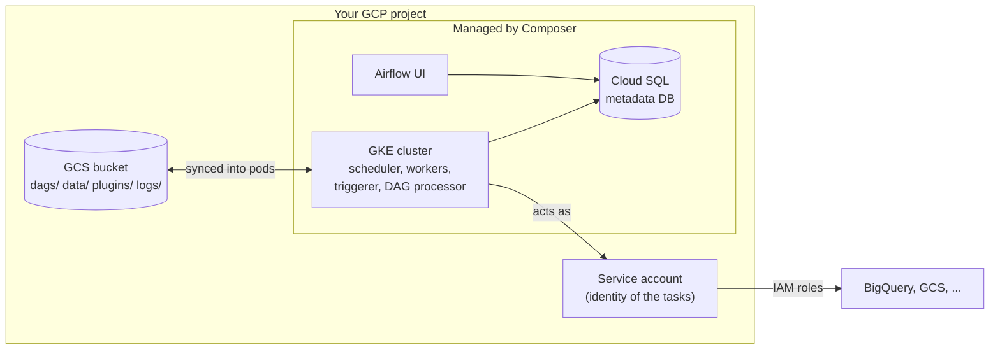

# 03 · Cloud Composer: provisioning an environment

---

## Part 1 — What Composer creates for you

A **Composer environment** = a full Airflow installation managed by Google.



| Version | Notes |
|---|---|
| Composer 1 | fixed node pool, min 3 nodes, no autoscaling. End of life |
| Composer 2 | GKE Autopilot, workers autoscale |
| **Composer 3** | current: infrastructure fully hidden, you size scheduler / workers / triggerer / web server in CPU + memory |

The **image version** pins both Composer and Airflow, e.g. `composer-3-airflow-3.x.y-build.z`. Check the list of supported versions in the Composer docs ("Composer versions") before creating; aliases like `composer-3-airflow-2` resolve to the latest build of that major version.

---

## Part 2 — Two steps: enable the API, create the environment

### Console

1. Search **Composer** in the console, click **Enable** on the Cloud Composer API (a minute or two).
2. **Create environment** -> Composer 3. Fill in:
   - **Name**: lowercase, letters, digits and hyphens (e.g. `airflow-lab`)
   - **Location**: e.g. `us-central1`
   - **Image version**: latest Airflow 3 build
   - **Service account**: default compute SA, or better a dedicated one (below)
   - **Environment size / resources**: *Small* is enough to learn
3. Create. Provisioning takes **about 20 to 30 minutes** (it builds the GKE workloads, Cloud SQL DB, bucket, installs Airflow).

### CLI (repeatable)

[`scripts/create-env.sh`](scripts/create-env.sh) does the same thing:

```bash
export PROJECT_ID=my-project
export REGION=us-central1
export ENV_NAME=airflow-lab
export IMAGE_VERSION=composer-3-airflow-3.x.y-build.z   # copy a real one from the versions page
./scripts/create-env.sh
```

It:
1. enables `composer.googleapis.com` (and BigQuery / Storage for later topics),
2. creates a dedicated service account `composer-lab-sa` with `roles/composer.worker`, BigQuery and Storage roles,
3. creates the environment,
4. prints the UI URL and the DAG bucket.

> **Warning:** The environment **bills every hour it exists**, even with zero DAGs. For learning: create, study, then delete with [19](../19-composer-cleanup/README.md).

---

## Part 3 — Useful facts once it exists

```bash
# Airflow UI URL
gcloud composer environments describe $ENV_NAME --location $REGION \
  --format="value(config.airflowUri)"

# DAG bucket prefix, e.g. gs://us-central1-airflow-lab-1234-bucket/dags
gcloud composer environments describe $ENV_NAME --location $REGION \
  --format="value(config.dagGcsPrefix)"
```

| Bucket folder | Mounted in workers at | Use |
|---|---|---|
| `dags/` | `/home/airflow/gcs/dags` | your DAG files (+ helper modules) |
| `data/` | `/home/airflow/gcs/data` | scripts, input/output files, SQL files |
| `plugins/` | `/home/airflow/gcs/plugins` | custom plugins |
| `logs/` | `/home/airflow/gcs/logs` | task logs |

Install extra PyPI packages for your DAGs:

```bash
gcloud composer environments update $ENV_NAME --location $REGION \
  --update-pypi-package "pandas>=2.2"
```

Override Airflow config (same as `airflow.cfg` / `AIRFLOW__SECTION__KEY`):

```bash
gcloud composer environments update $ENV_NAME --location $REGION \
  --update-airflow-configs core-dags_are_paused_at_creation=True
```

Set environment variables:

```bash
gcloud composer environments update $ENV_NAME --location $REGION \
  --update-env-variables ENVIRONMENT=lab
```

---

## Cheat sheet

```bash
gcloud services enable composer.googleapis.com
gcloud composer environments create ENV --location REGION --image-version VERSION --service-account SA
gcloud composer environments list --locations REGION
gcloud composer environments describe ENV --location REGION
gcloud composer environments update ENV --location REGION --update-pypi-package PKG
gcloud composer environments delete ENV --location REGION
```
