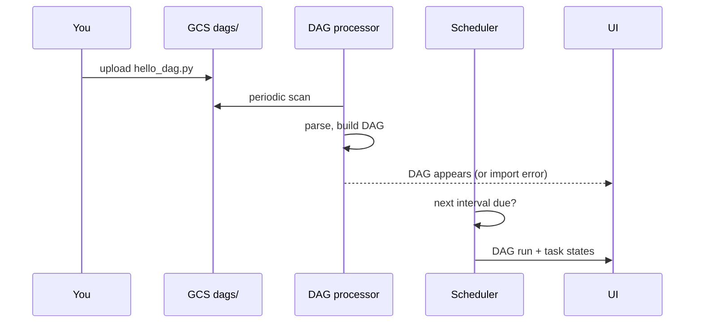

# 04 · Web UI & Composer buckets

---

## Part 1 — Composer console page

**Composer -> Environments** lists your environments. A green check = healthy and running. From here you can create, delete, or click an environment:

| Tab | What's there |
|---|---|
| **Monitoring** | environment health, scheduler heartbeat, worker CPU / memory, DAG parse times |
| **Logs** | scheduler, worker, DAG processor logs (Cloud Logging) |
| **DAGs** | list of DAGs, quick links |
| **Environment configuration** | image version, service account, **Airflow web UI** link, **DAGs folder** link, sizes |
| **Airflow configuration overrides / Environment variables / PyPI packages** | the knobs from [03](../03-composer-environment/README.md) |

> **Warning:** An environment consumes CPU, memory, a Cloud SQL DB and storage the whole time it exists. Not using it for a few days? Delete it.

---

## Part 2 — The Airflow UI

Open it from **Environment configuration -> Airflow web UI** (Google sign-in, access controlled by IAM roles like `roles/composer.user`).

### DAGs list (home)

| Element | Meaning |
|---|---|
| **Pause / unpause toggle** | paused DAGs are never scheduled. New DAGs often start paused |
| **Runs** | circles per state: success (green), running (light green), failed (red), queued (grey) |
| **Schedule** | `@daily`, cron, `None` (manual only)... |
| **Last run / Next run** | when it ran, when it will run |
| **Trigger** (play button) | start a run right now, regardless of schedule. Can pass a config / params |

### Inside a DAG

| View | Use |
|---|---|
| **Grid** | rows = tasks, columns = DAG runs, colour = state. Main view for history |
| **Graph** | the dependency diagram of one run |
| **Code** | the DAG source as Airflow parsed it (check your upload actually arrived) |
| **Details / Run duration / Task duration** | timings, trends |
| **Task instance -> Logs** | stdout / stderr of the task, the first place to debug |
| **Task instance -> XCom** | values the task pushed (see [11](../11-xcom/README.md)) |
| **Task instance -> Clear** | re-run that task (and optionally downstream) |
| **Mark success / failed** | manually set the state |

### Admin menu

| Item | See |
|---|---|
| **Variables** | [07](../07-variables/README.md) |
| **Connections** | [09](../09-connections/README.md) |
| **Pools** | limit how many tasks of a kind run at once |
| **Plugins, Providers, Config** | what's installed / configured |

### Browse menu

DAG runs, task instances, jobs, audit log (who triggered / cleared what), and in 2.x "SLA misses".

---

## Part 3 — Deploying DAGs = copying files to the bucket

There is no "deploy" button: **whatever is in `dags/` gets parsed**. Three ways to put a file there:

```bash
# 1. Console: Environment configuration -> DAGs folder -> Upload files

# 2. gcloud wrapper
gcloud composer environments storage dags import \
  --environment $ENV_NAME --location $REGION --source hello_dag.py

# 3. plain gsutil / gcloud storage into the bucket
gcloud storage cp hello_dag.py gs://<bucket>/dags/
```

Or source the helpers once and use the short versions everywhere in this repo:

```bash
source 03-composer-environment/scripts/env.sh
upload_dag 05-dag-structure/hello_dag.py
upload_data 08-bash-scripts/scripts/greet.py scripts
airflow_cli dags list
airflow_cli dags trigger hello_dag
```

Then wait: the DAG processor scans the folder periodically (about 30 s to a few minutes in Composer). Refresh the UI. Problems parsing the file show up as **"Import errors"** at the top of the DAG list.



Delete a DAG: remove the file from the bucket (`gcloud composer environments storage dags delete --source hello_dag.py ...`), then optionally delete its history in the UI.

---

## Cheat sheet

```bash
gcloud composer environments storage dags   import|list|delete  --environment E --location L --source F
gcloud composer environments storage data   import|list|delete  --environment E --location L --source F
gcloud composer environments run E --location L dags list
gcloud composer environments run E --location L dags trigger -- DAG_ID
gcloud composer environments run E --location L dags list-import-errors
```
