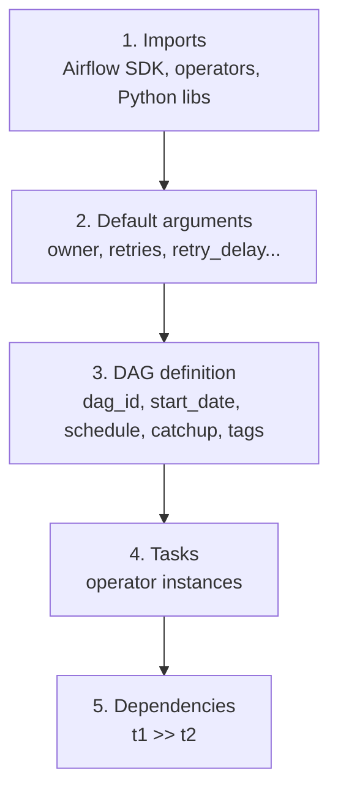
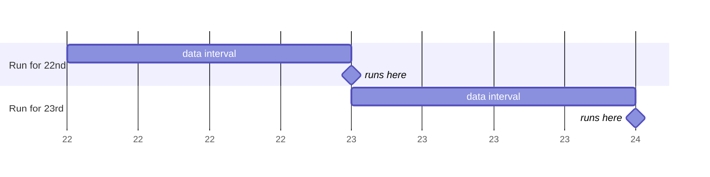

# 05 · DAG file structure + first DAG

---

## Part 1 — The five sections of a DAG file

Every DAG file can be read as five blocks:



| Section | What goes there |
|---|---|
| **Imports** | `from airflow.sdk import DAG`, operator classes, `datetime` |
| **Default args** | a dict applied to **every task**: `owner`, `retries`, `retry_delay`, `email_on_failure`, `execution_timeout` |
| **DAG** | `dag_id` (name shown in the UI), `start_date`, `schedule`, `catchup`, `tags`, `description` |
| **Tasks** | `BashOperator(...)`, `@task` functions... each with a unique `task_id` |
| **Dependencies** | `>>`, `<<`, `chain()` |

See [`hello_dag.py`](hello_dag.py): two tasks, a Python one that prints a greeting and a Bash one that prints a goodbye. The Bash task only runs if the Python one succeeds.


The same DAG written with decorators: [`hello_dag_taskflow.py`](hello_dag_taskflow.py).

---

## Part 2 — Scheduling fields

### `start_date` + `schedule`

- `start_date`: the first **logical date** from which runs may exist. Use a fixed date, never `datetime.now()`.
- `schedule`: how often. Examples:

| Value | Meaning |
|---|---|
| `None` | only when triggered manually / by API |
| `"@daily"` | every day at 00:00 UTC |
| `"@hourly"`, `"@weekly"`, `"@monthly"` | presets |
| `"0 6 * * 1-5"` | cron: 06:00 on weekdays |
| `timedelta(hours=4)` | every 4 hours |
| `[Asset("gs://bucket/file.csv")]` | when an upstream task updates that asset (data-aware) |

### Data intervals: why old daily runs "ran a day late"

Airflow 1.x / 2.x (and Airflow 3 with `create_cron_data_intervals=True` or `CronDataIntervalTimetable`): a daily DAG run with logical date **2025-03-22** covers the interval `2025-03-22 00:00 -> 2025-03-23 00:00`, and it starts **at the end** of that interval, i.e. on 2025-03-23 00:00. It processes yesterday's data once yesterday is complete.



Airflow 3 default for cron strings and presets (`CronTriggerTimetable`): the run starts **at** the scheduled time and `logical_date` = that time. A `@daily` run that starts on 2025-03-23 00:00 has logical date 2025-03-23. If your task should process "yesterday", compute it explicitly (e.g. `{{ macros.ds_add(ds, -1) }}`) or switch the timetable back to data intervals.

> **Warning:** This is the most common source of "off by one day" bugs when moving DAGs between Airflow 2 and 3.

### `catchup`

If `start_date` is in the past, should the scheduler create a run for **every missed interval**?

- `catchup=True`: start date 22 March, today 4 April, daily schedule -> about 13 runs are created immediately (backfill).
- `catchup=False` (**default in Airflow 3**): only the latest interval runs.

> **Tip:** Keep `catchup=False` while learning, or a fresh upload with an old `start_date` will spawn dozens of runs. Backfill on purpose with `airflow backfill create --dag-id X --from-date ... --to-date ...`.

---

## Part 3 — Upload and watch it run

```bash
source 03-composer-environment/scripts/env.sh
upload_dag 05-dag-structure/hello_dag.py
```

1. Wait for `hello_dag` to appear in the UI; unpause it.
2. **Grid** view: one column per run, both squares green when done.
3. Click `hello_python` -> **Logs**: you see `Hello from Python!`. `goodbye_bash` -> **Logs**: `Goodbye from Bash`.
4. **Trigger** to run it again now. **Clear** a task to re-run just that task.

Locally, no scheduler needed:

```bash
airflow dags test hello_dag
```

### Why the dependency matters

If `hello_python` fails (try `raise ValueError` in it), `goodbye_bash` goes to `upstream_failed` and never runs. In a long nightly pipeline this is what prevents half-processed data from flowing downstream. After fixing, **Clear** the failed task and Airflow continues from there.

---

## Cheat sheet

```python
from datetime import datetime, timedelta
from airflow.sdk import DAG

default_args = {"owner": "me", "retries": 1, "retry_delay": timedelta(minutes=5)}

with DAG(
    dag_id="x",
    start_date=datetime(2025, 1, 1),
    schedule="@daily",
    catchup=False,
    default_args=default_args,
    tags=["learning"],
):
    ...
```
