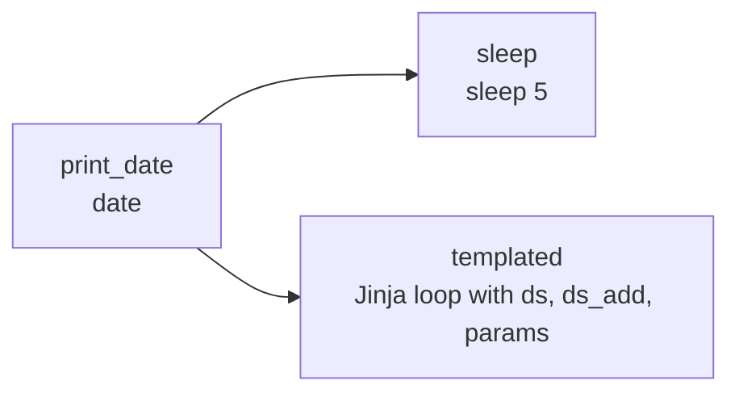

# 06 · Templating (Jinja, macros, params) & dependencies

---

## Part 1 — What templating is

Some operator arguments are **templated**: before the task runs, Airflow renders them with **Jinja**, replacing `{{ ... }}` with values known only at run time (the run's date, params, variables...).

```python
BashOperator(task_id="show", bash_command="echo run date is {{ ds }}")
# rendered at run time to:  echo run date is 2025-04-04
```

Which arguments are templated? Each operator lists them in `template_fields` (e.g. `bash_command`, `env` for BashOperator; `sql` for SQL operators; `op_args`, `op_kwargs`, `templates_dict` for PythonOperator). Files ending in `.sh` / `.sql` passed to those fields are read and rendered too.

> **Tip:** After a run, the task's **Rendered Template** tab in the UI shows exactly what the command became. Great for debugging.

### Built-in template variables (most used)

| Variable | Example value |
|---|---|
| `{{ ds }}` | `2025-04-04` (logical date, `YYYY-MM-DD`) |
| `{{ ds_nodash }}` | `20250404` |
| `{{ ts }}` | `2025-04-04T00:00:00+00:00` |
| `{{ logical_date }}` | pendulum datetime object (was `execution_date`) |
| `{{ data_interval_start }}` / `{{ data_interval_end }}` | interval bounds |
| `{{ dag.dag_id }}`, `{{ task.task_id }}`, `{{ run_id }}` | identifiers |
| `{{ params.my_param }}` | values from `params=` on the DAG or task |
| `{{ var.value.my_var }}` / `{{ var.json.cfg.key }}` | Variables ([07](../07-variables/README.md)) |
| `{{ conn.my_conn.host }}` | Connection fields ([09](../09-connections/README.md)) |
| `{{ ti.xcom_pull(task_ids='x') }}` | XCom values ([11](../11-xcom/README.md)) |

### Macros

`macros` gives helper functions inside templates:

```jinja
{{ macros.ds_add(ds, 7) }}            {# 7 days after ds  -> 2025-04-11 #}
{{ macros.ds_add(ds, -1) }}           {# yesterday #}
{{ macros.ds_format(ds, "%Y-%m-%d", "%d/%m/%Y") }}
{{ macros.datetime.now() }}
```

Jinja control flow works too (``, ``), see [`templating_dag.py`](templating_dag.py).

---

## Part 2 — Dependency syntax

```python
t1 >> t2          # t1 runs first, then t2         (t2 is downstream of t1)
t2 << t1          # exactly the same thing
t1.set_downstream(t2)   # same, method style
t2.set_upstream(t1)     # same

t1 >> [t2, t3]    # fan out: t2 and t3 after t1, in parallel
[t2, t3] >> t4    # fan in: t4 after both
```

> **Warning:** `t2 << t1` reads right to left. Mixing `>>` and `<<` in one file is legal but confusing; pick `>>` and stick to it.

---

## Part 3 — Example DAG

[`templating_dag.py`](templating_dag.py) has three tasks:



`templated` runs this Bash, rendered per run:

```jinja

  echo "ds = {{ ds }}"
  echo "ds + 7 = {{ macros.ds_add(ds, 7) }}"
  echo "param = {{ params.my_param }}"

```

```bash
airflow dags test templating_dag 2025-04-04
# or upload and trigger, then open templated -> Logs and Rendered Template
```

Expected log lines: `ds = 2025-04-04`, `ds + 7 = 2025-04-11`, `param = Parameter I passed in` (three times).

Override a param when triggering: **Trigger DAG** -> edit the JSON config (`{"my_param": "something else"}`), or `airflow dags trigger templating_dag -c '{"my_param": "x"}'`.

---

## Cheat sheet

```text
{{ ds }}  {{ ds_nodash }}  {{ ts }}  {{ logical_date }}  {{ run_id }}
{{ macros.ds_add(ds, N) }}  {{ params.x }}  {{ var.value.x }}  {{ conn.id.host }}
Rendered Template tab = what actually ran
>> downstream, << upstream, [a, b] >> c fan in
```
