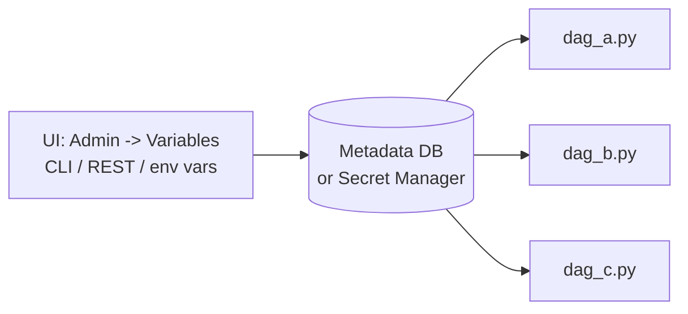
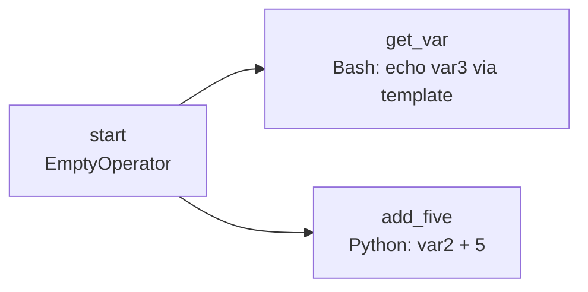

# 07 · Variables

---

## Part 1 — What and why

A **Variable** = a key / value pair stored in the **metadata DB** (or a secrets backend), readable from any DAG.

Problem it solves: the same value (a bucket name, a threshold, an email list, an environment name) is hard-coded in 30 DAG files. It changes, and you have to edit 30 files. With a Variable you change it **once** in the UI.

| Good for | Not for |
|---|---|
| config values: bucket names, paths, thresholds, feature flags | passwords / API keys -> use **Connections** or a secrets backend |
| small JSON configs | big data (it's a DB row) |
| per-environment values (dev vs prod) | values that change on every run -> use params / XCom |



---

## Part 2 — Creating variables

### UI

**Admin -> Variables -> +**: key, value, optional description. You can also **import** a JSON file of many variables at once: [`variables.json`](variables.json).

### CLI

```bash
airflow variables set var1 "Hello"
airflow variables set var2 5
airflow variables set app_config '{"bucket": "my-bucket", "threshold": 0.8}'
airflow variables import 07-variables/variables.json
airflow variables get var1
airflow variables list
airflow variables delete var1
```

In Composer, wrap it: `airflow_cli variables set var1 Hello` (helper from [03](../03-composer-environment/scripts/env.sh)), or

```bash
gcloud composer environments run $ENV_NAME --location $REGION variables -- set var1 Hello
```

### Environment variables

`AIRFLOW_VAR_<KEY>` is read as Variable `<key>`, never stored in the DB:

```bash
export AIRFLOW_VAR_VAR1=Hello
```

> **Tip:** On GCP you can point Airflow at **Secret Manager** as a secrets backend; then `Variable.get("x")` reads secret `airflow-variables-x`. Lookup order: secrets backend -> env vars -> metadata DB.

---

## Part 3 — Reading variables in a DAG

Two ways, with an important difference:

```python
# 1. Templated (lazy): resolved only when the task runs
BashOperator(task_id="t", bash_command="echo {{ var.value.var1 }}")
BashOperator(task_id="t2", bash_command="echo {{ var.json.app_config.bucket }}")

# 2. Python (inside a task!)
from airflow.sdk import Variable

@task
def compute():
    v = int(Variable.get("var2"))
    cfg = Variable.get("app_config", deserialize_json=True)
```

> **Warning:** Do **not** call `Variable.get()` at the top level of the DAG file (outside tasks). The file is parsed every 30 s or so; each top-level call is a DB / secrets-backend hit on every parse, and in Airflow 3 top-level access is discouraged and may not work. Use templates or read inside the task.

### Example

[`variables_dag.py`](variables_dag.py), with variables `var1 = "Hello"`, `var2 = 5`, `var3 = "Hello Variables!"`:



```bash
airflow variables import 07-variables/variables.json
airflow dags test variables_dag
```

Logs: `get_var` prints `Hello Variables!`; `add_five` prints `var2 + 5 = 10`.

---

## Cheat sheet

```text
UI: Admin -> Variables        CLI: airflow variables set|get|list|import|export|delete
Env: AIRFLOW_VAR_<KEY>=value
Template: {{ var.value.key }}   {{ var.json.key.field }}
Python:   Variable.get("key", default=None, deserialize_json=False)   (inside tasks)
```
