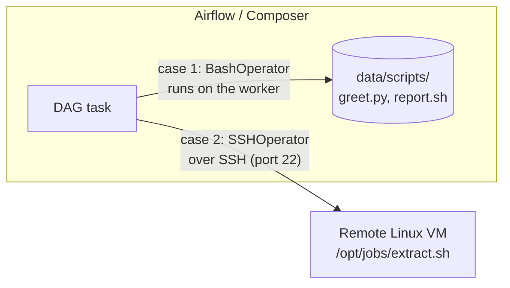
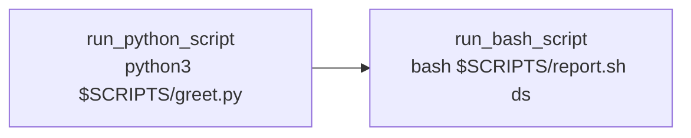
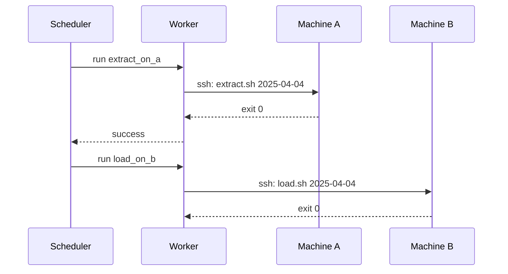

# 08 · Calling Bash scripts (other folder / other machine)

So far every command lived inside the DAG file. Real pipelines call **scripts that live elsewhere**:

1. in **another folder** of the Airflow environment (e.g. Composer's `data/` folder),
2. on **another machine** entirely (an ERP box, an on-prem Linux server).



> **Tip:** To be good at Airflow you need Python **and** Linux basics (paths, permissions, exit codes, `set -e`). A Bash task succeeds if the command exits `0` and fails on any other exit code.

---

## Part 1 — Script in another folder (same environment)

Composer mounts the bucket's `data/` folder on every worker at `/home/airflow/gcs/data/`. Put scripts there, call them by absolute path.

**Order matters:** upload the scripts **first**, then the DAG. If the DAG arrives first and gets scheduled, its tasks fail with "file not found".

```bash
source 03-composer-environment/scripts/env.sh
upload_data 08-bash-scripts/scripts/greet.py scripts
upload_data 08-bash-scripts/scripts/report.sh scripts
upload_dag  08-bash-scripts/call_script_dag.py
```

[`call_script_dag.py`](call_script_dag.py) reads the folder from a Variable (`scripts_dir`) so the same DAG works locally and in Composer:



```bash
# locally
airflow variables set scripts_dir "$PWD/08-bash-scripts/scripts"
airflow dags test call_script_dag
```

> **Warning:** If `bash_command` ends in `.sh` (or `.bash`), Airflow treats it as a **Jinja template file** to load, and fails with `TemplateNotFound`. Either add a trailing space (`"bash script.sh "`), pass arguments after it, or use `@task.bash`.

Other BashOperator options worth knowing:

| Arg | Use |
|---|---|
| `env={"KEY": "value"}` | environment variables for the command (replaces the inherited env unless `append_env=True`) |
| `cwd="/path"` | working directory |
| `skip_on_exit_code=99` | exit code that marks the task **skipped** instead of failed |
| `output_processor` | post-process stdout before it goes to XCom |

The last line of stdout is pushed to XCom by default (`do_xcom_push=True`).

---

## Part 2 — Script on another machine

The worker can't run a file that only exists on another server. It has to **connect** to it, usually over **SSH**, and run the command there.

1. Install the provider (Composer: add PyPI package `apache-airflow-providers-ssh`).
2. Create an **SSH connection** (`ssh_default` or your own id): host = IP / DNS of the machine, login, port 22, and a private key (or password). See [09](../09-connections/README.md).
3. Use `SSHOperator`:

```python
from airflow.providers.ssh.operators.ssh import SSHOperator

run_remote = SSHOperator(
    task_id="run_remote",
    ssh_conn_id="erp_server",
    command="bash /opt/jobs/extract.sh {{ ds }}",
    cmd_timeout=600,
)
```

[`ssh_remote_dag.py`](ssh_remote_dag.py) chains two remote machines: extract on machine A, only if it succeeds, load on machine B.



Network notes for Composer: the workers must be able to reach the host (public IP + firewall rule allowing SSH from Composer's egress, or a private IP through VPC / VPN / Interconnect). Ask the machine's admin for the SSH port and an account with only the permissions the job needs.

> **Tip:** For GCE VMs, `ComputeEngineSSHHook` (Google provider) can use OS Login / IAP instead of managing keys yourself.

---

## Cheat sheet

```python
BashOperator(task_id="t", bash_command="python3 /home/airflow/gcs/data/scripts/greet.py")
BashOperator(task_id="t", bash_command="bash {{ var.value.scripts_dir }}/report.sh {{ ds }}")
SSHOperator(task_id="t", ssh_conn_id="my_ssh", command="bash /opt/jobs/x.sh")
```
