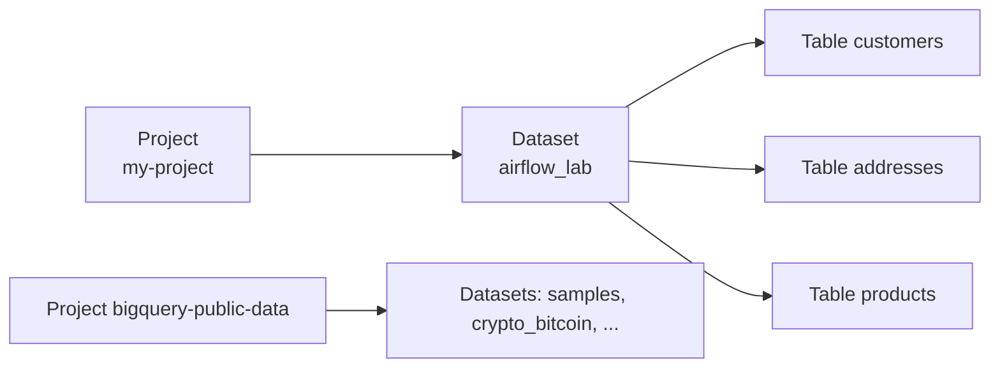
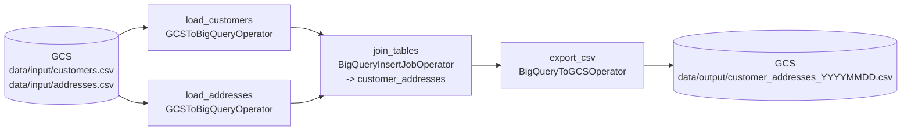

# 10 · BigQuery pipeline

---

## Part 1 — What BigQuery is

Storing and querying massive datasets on your own hardware is slow and expensive: you buy, size and maintain database servers. **BigQuery** is Google's **serverless data warehouse**:

- no servers or indexes to manage; you create datasets and tables and run SQL
- scans billions of rows in seconds (columnar storage, massively parallel execution)
- pay for storage + bytes scanned (or reserved slots)
- loads from CSV, JSON, Avro, Parquet, from GCS or local files, or streams

Hierarchy: **project -> dataset -> table**. Referenced in SQL as `` `project.dataset.table` `` (project optional when it's the default).



> **Tip:** `bigquery-public-data` has free public datasets (hundreds of millions of rows) to practise queries on. The first 1 TB scanned per month is free.

---

## Part 2 — Tables by hand (console and bq CLI)

### Console

**BigQuery -> Explorer -> your project -> Create dataset** (`airflow_lab`), then **Create table**:
- *Empty table*: define the schema (e.g. `vendor_id INT64`, `vendor_name STRING`, `address STRING`, `city STRING`, `country STRING`).
- *Upload*: choose a CSV (e.g. [`data/products.csv`](data/products.csv)), set the schema or tick *Auto detect*, skip 1 header row. Preview shows the rows a few seconds later.

### bq CLI

```bash
bq mk --dataset my-project:airflow_lab

bq mk --table airflow_lab.vendors \
  vendor_id:INT64,vendor_name:STRING,address:STRING,city:STRING,country:STRING

bq load --source_format=CSV --skip_leading_rows=1 \
  airflow_lab.products data/products.csv \
  product_id:INT64,name:STRING,unit_of_measure:STRING

bq query --use_legacy_sql=false 'SELECT * FROM airflow_lab.products'
```

Joining tables works like any SQL DB:

```sql
SELECT c.name, c.location, a.street
FROM airflow_lab.customers AS c
JOIN airflow_lab.addresses AS a USING (customer_id);
```

Doing this by hand once is fine; doing it every night is what Airflow is for.

---

## Part 3 — The pipeline

[`bigquery_pipeline_dag.py`](bigquery_pipeline_dag.py): load two CSVs, join them, export the result as a CSV.



| Operator | Package | Does |
|---|---|---|
| `GCSToBigQueryOperator` | `providers.google.cloud.transfers.gcs_to_bigquery` | load files from GCS into a table |
| `BigQueryInsertJobOperator` | `providers.google.cloud.operators.bigquery` | run any BigQuery job (query, load, copy, extract) from a job `configuration` dict |
| `BigQueryToGCSOperator` | `providers.google.cloud.transfers.bigquery_to_gcs` | export a table to GCS (CSV, JSON, Avro, Parquet) |
| `BigQueryCheckOperator` / `BigQueryValueCheckOperator` | same | data quality: fail the task if a query returns false / unexpected value |
| `BigQueryCreateEmptyDatasetOperator`, `BigQueryCreateTableOperator` | same | DDL from the DAG |

> **Warning:** `BigQueryOperator` (seen in old examples with `bql=` / `sql=`) is gone. Use `BigQueryInsertJobOperator` with `configuration={"query": {...}}`.

Writing the output into the environment's `data/` folder means it also appears on workers at `/home/airflow/gcs/data/output/`, so a later task could read it as a normal file.

### Run it

```bash
source 03-composer-environment/scripts/env.sh
./10-bigquery-pipeline/bq-setup.sh                 # dataset, input files, Variables
upload_dag 10-bigquery-pipeline/bigquery_pipeline_dag.py
airflow_cli dags trigger bigquery_pipeline_dag
```

Check:

```bash
bq query --use_legacy_sql=false 'SELECT * FROM airflow_lab.customer_addresses'
gcloud storage cat "gs://$(gcloud composer environments describe $ENV_NAME --location $REGION \
  --format='value(config.dagGcsPrefix)' | sed -E 's#gs://([^/]+)/.*#\1#')/data/output/customer_addresses_*.csv"
```

Note the `LEFT JOIN`: Dana (customer 4) has no address and appears with empty street; address for customer 5 has no customer and is dropped.

Permissions needed by the environment SA: `roles/bigquery.jobUser` + `roles/bigquery.dataEditor` (on the dataset) and `roles/storage.objectAdmin` on the bucket. The lab script grants broader roles for simplicity.

---

## Cheat sheet

```python
BigQueryInsertJobOperator(task_id="q", configuration={"query": {"query": SQL, "useLegacySql": False}})
GCSToBigQueryOperator(task_id="l", bucket=B, source_objects=["path/*.csv"], destination_project_dataset_table="ds.t")
BigQueryToGCSOperator(task_id="e", source_project_dataset_table="ds.t", destination_cloud_storage_uris=["gs://b/out.csv"])
```

```bash
bq ls | bq show ds.t | bq head -n 10 ds.t | bq rm -r -f ds
```
