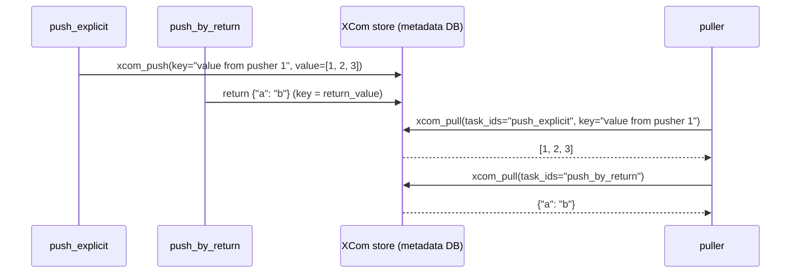
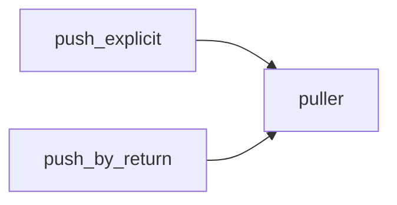

# 11 · XCom: passing data between tasks

---

## Part 1 — What XCom is

Tasks are isolated: they may run on different workers, in different processes, at different times. A Python variable in task 1 does not exist in task 2.

**XCom** ("cross-communication") is how tasks exchange **small** pieces of data. An XCom is a row identified by:

| Field | Example |
|---|---|
| `key` | `return_value` (default) or any string |
| `value` | JSON-serialisable value |
| `dag_id`, `task_id`, `run_id`, `map_index` | who pushed it, in which run |
| `timestamp` | when |



Two ways to **push**:
1. **Return a value** from a Python callable / `@task` -> stored with key `return_value` (also BashOperator: the last stdout line).
2. **Explicit**: `ti.xcom_push(key="...", value=...)`.

**Pull**: `ti.xcom_pull(task_ids="...", key="return_value")`, or in templates `{{ ti.xcom_pull(task_ids='x') }}`.

> **Warning:** XCom lives in the metadata DB (by default). Pass **references** (a GCS path, a table name, a row count), not datasets. For big objects configure an object storage XCom backend, or just write to GCS and pass the path.

---

## Part 2 — Getting the task instance (`ti`) and `**kwargs`

Inside a Python callable, Airflow passes the **context** (ti, ds, params, dag_run...) as keyword arguments. Since you don't know (or care) about all of them, accept `**kwargs`, or name only the ones you need:

```python
def push(**kwargs):
    kwargs["ti"].xcom_push(key="k", value=1)

def push(ti):           # same: Airflow injects only the context keys you name
    ti.xcom_push(key="k", value=1)
```

Reminder: `*args` collects extra positional arguments into a tuple, `**kwargs` collects extra keyword arguments into a dict.

> **Tip:** Old code uses `provide_context=True` on PythonOperator. That flag is gone; context is always available.

---

## Part 3 — Example

[`xcom_dag.py`](xcom_dag.py), classic operators:



- `push_explicit` -> `ti.xcom_push(key="value from pusher 1", value=[1, 2, 3])`
- `push_by_return` -> `return {"a": "b"}`
- `puller` pulls both, checks them, prints them

After a run, open each task instance -> **XCom** tab:

| Task | XCom entries |
|---|---|
| `push_explicit` | `value from pusher 1` = `[1, 2, 3]` (no `return_value`: the callable returns `None`) |
| `push_by_return` | `return_value` = `{"a": "b"}` |
| `puller` | none (it doesn't push or return anything) |

[`xcom_taskflow_dag.py`](xcom_taskflow_dag.py): the same with `@task`. Passing a task's output as an argument to another task **is** an XCom pull, and it also creates the dependency automatically:

```python
@task
def extract() -> dict:
    return {"rows": 42}

@task
def report(stats: dict):
    print(stats["rows"])

report(extract())     # extract >> report, value passed via XCom
```

```bash
airflow dags test xcom_dag
airflow dags test xcom_taskflow_dag
```

---

## Cheat sheet

```python
ti.xcom_push(key="k", value=v)
ti.xcom_pull(task_ids="t", key="k")              # key defaults to "return_value"
ti.xcom_pull(task_ids=["a", "b"])                # list of values
"{{ ti.xcom_pull(task_ids='t') }}"               # in templated fields
BashOperator(..., do_xcom_push=False)            # don't store stdout
```
