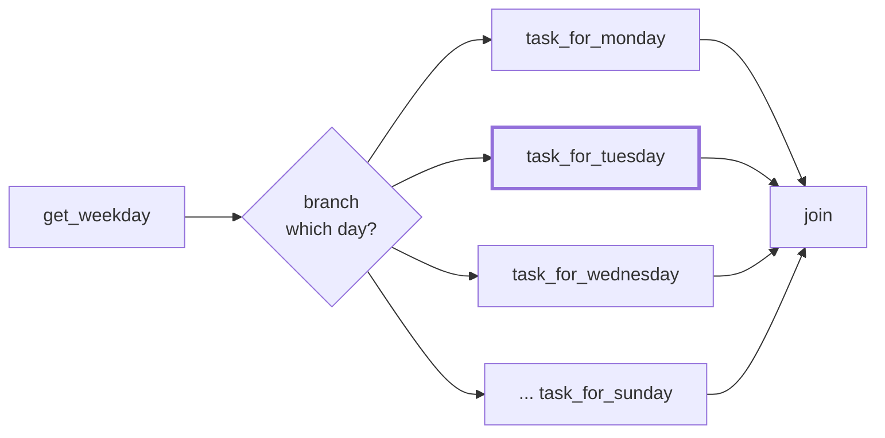

# 12 · Branching

---

## Part 1 — Static vs dynamic paths

Until now the DAG shape decided everything **at design time**: `t1`, `t2`, `t3` run in parallel, `t4` after all three. You know before deploying which tasks will run.

Sometimes the path depends on something known only **at run time**:
- run `t1` on Mondays and `t2` on Tuesdays
- full reload if the source table changed schema, incremental otherwise
- skip the export if the upstream query returned 0 rows

That's **branching**: a task decides which downstream task(s) continue; the others are marked **skipped**.



On a Tuesday only `task_for_tuesday` runs; the other six are skipped.

---

## Part 2 — How to branch

| Tool | Use |
|---|---|
| `@task.branch` / `BranchPythonOperator` | your function returns the `task_id` (or list of ids) to follow |
| `BranchDayOfWeekOperator` | built-in: follow one path on given weekdays |
| `BranchDateTimeOperator` | built-in: follow one path inside a time window |
| `@task.short_circuit` / `ShortCircuitOperator` | return `False` -> skip **everything** downstream |
| `BranchSQLOperator` | branch on the result of a SQL query |

```python
@task.branch
def branch(day: str) -> str:
    return f"task_for_{day}"       # must match a direct downstream task_id
```

### The join trap: trigger rules

By default a task runs only if **all** upstream tasks succeeded (`trigger_rule="all_success"`). After a branch, the join task has skipped parents, so with the default it gets **skipped too**.

Fix: give the join a trigger rule that tolerates skips:

```python
join = EmptyOperator(task_id="join", trigger_rule="none_failed_min_one_success")
```

| Trigger rule | Runs when |
|---|---|
| `all_success` (default) | all parents succeeded |
| `all_failed` | all parents failed (cleanup / alert paths) |
| `all_done` | all parents finished, whatever the result |
| `one_success` / `one_failed` | as soon as one parent succeeded / failed |
| `none_failed` | no parent failed (success or skipped) |
| `none_failed_min_one_success` | no parent failed and at least one succeeded (typical join after branch) |
| `none_skipped` | no parent was skipped |
| `always` | always |

> **Tip:** Branching gets complicated fast. Keep the branch function tiny and pure, put the decision data in XCom or params, and draw the graph before coding it.

---

## Part 3 — Example

[`branching_dag.py`](branching_dag.py):

1. `get_weekday` returns the weekday name of the run's logical date (via XCom).
2. `branch` returns `task_for_<day>`.
3. Seven `EmptyOperator`s, one per day; only one runs.
4. `join` with `none_failed_min_one_success`.

```bash
airflow dags test branching_dag 2025-04-08     # a Tuesday
```

In the Graph view: `task_for_tuesday` green, the other six pink (skipped), `join` green.

Using the logical date (not `datetime.now()`) means re-running an old run gives the same branch, which is what you want for reproducible pipelines.

---

## Cheat sheet

```python
@task.branch
def choose(**context) -> str | list[str] | None: ...

ShortCircuitOperator(task_id="go_on", python_callable=lambda: rows > 0)
EmptyOperator(task_id="join", trigger_rule="none_failed_min_one_success")
```
