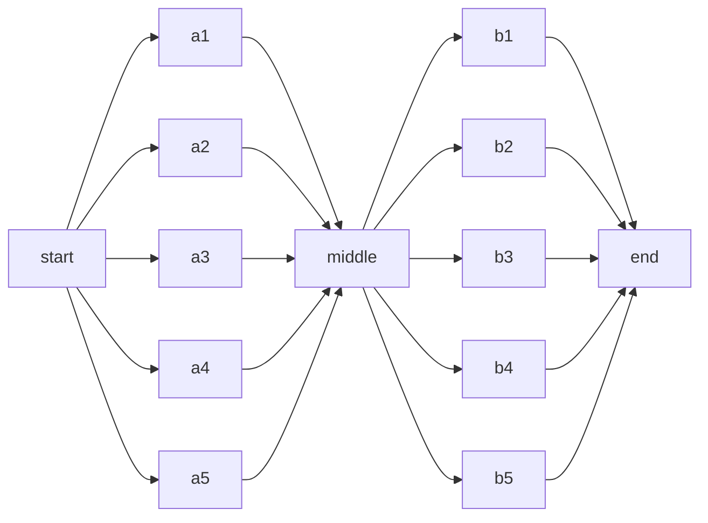
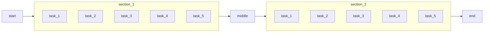

# 13 · TaskGroups (and the old SubDAGs)

---

## Part 1 — The problem

After a fan-out, the next task must wait for **every** parallel task:



With dozens of tasks the graph turns into spaghetti. You want to treat each block as **one box** ("section 1 succeeded, go on"), and drill into it only when needed:



---

## Part 2 — SubDAGs (history) vs TaskGroups (now)

The original answer was the **SubDAG**: a whole child DAG wrapped in a `SubDagOperator`, shown as one node you could zoom into.

It had real problems:
- the child DAG was a separate DAG with its own runs and scheduling, so it could **deadlock** (parent slot waiting on child tasks that couldn't get a slot)
- ran with its own executor settings, ignored parallelism limits
- confusing to clear / backfill / debug

SubDAGs were deprecated in 2.0 and **removed in Airflow 3**.

The replacement is the **TaskGroup**: purely a **visual and naming grouping** inside the same DAG. Tasks keep running as normal tasks of the parent DAG; no extra DAG runs, no special executor.

| | SubDAG | TaskGroup |
|---|---|---|
| Is a separate DAG | yes | no |
| Deadlock risk | yes | no |
| Collapsible in UI | yes | yes |
| Dependencies to/from the group | via the operator | `group >> task` directly |
| Task id | `parent.child` DAG + task | `group_id.task_id` |
| Airflow 3 | removed | the way |

---

## Part 3 — Using TaskGroups

```python
from airflow.sdk import TaskGroup

with TaskGroup("section_1") as section_1:
    for i in range(1, 6):
        EmptyOperator(task_id=f"task_{i}")      # real id: section_1.task_1

start >> section_1 >> middle
```

Decorator style, handy when the group is built by a function / reused:

```python
from airflow.sdk import task_group

@task_group
def section(n: int):
    for i in range(1, n + 1):
        EmptyOperator(task_id=f"task_{i}")

section.override(group_id="section_2")(5)
```

Groups can be **nested**, can have their own `default_args`, and `prefix_group_id=False` keeps the plain task ids.

[`taskgroups_dag.py`](taskgroups_dag.py) builds the diagram above: `start >> section_1 >> some_other_task >> section_2 >> end`, with five tasks per section. In the Graph view each section shows collapsed; click it to expand.

> **Tip:** Need a true *separate* DAG instead (different owner, schedule, retries)? Don't nest. Use **`TriggerDagRunOperator`** to start another DAG, or **Assets** (data-aware scheduling) so DAG B runs when DAG A updates a dataset.

```bash
airflow dags test taskgroups_dag
```

---

## Cheat sheet

```python
with TaskGroup("g", tooltip="...", default_args={...}) as g: ...
@task_group
def g(): ...
a >> g >> b
TriggerDagRunOperator(task_id="t", trigger_dag_id="other_dag", wait_for_completion=True)
```
