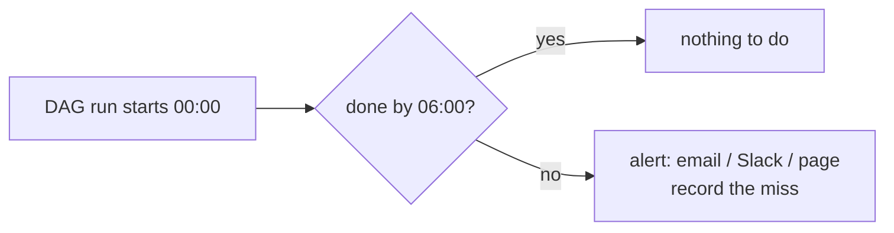
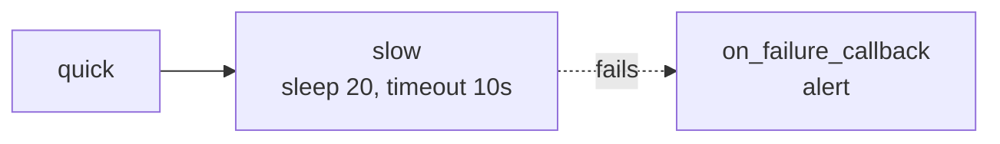

# 14 · SLAs, timeouts & alerting

---

## Part 1 — The idea

A **Service Level Agreement** here = "this task / DAG must be done by time X". If it isn't, someone gets told, even though nothing *failed*. Typical example: the sales dashboard must be refreshed by 06:00; the pipeline is slow today, still running at 06:30, no error yet, but the business needs to know.



Dependencies already stop downstream tasks when something **fails**. SLAs cover the other case: **too slow but not failed**.

---

## Part 2 — What exists depending on the version

### Airflow 2.x: `sla` + `sla_miss_callback`

```python
# Airflow 2 only
default_args = {"sla": timedelta(hours=2), "email": ["oncall@example.com"]}
with DAG(..., sla_miss_callback=notify_sla_miss): ...
```

Misses were recorded in the DB and listed in **Browse -> SLA Misses**, with an email per miss. Known to be unreliable (measured from the scheduled time, not the task start, odd behaviour with catchup and manual runs).

### Airflow 3.0: `sla` is removed

Use these instead, they cover most needs:

| Mechanism | Scope | Effect |
|---|---|---|
| `execution_timeout=timedelta(minutes=30)` | task | task **fails** if it runs longer (then retries / alerts as usual) |
| `dagrun_timeout=timedelta(hours=6)` | DAG run | run marked **failed** if still going after that |
| `on_failure_callback`, `on_retry_callback`, `on_success_callback` | task or DAG | call any function: Slack, email, PagerDuty |
| `email_on_failure=True`, `email=[...]` | task | email via SMTP / SendGrid (configure `[smtp]` or the SendGrid provider) |
| Notifiers (`SlackNotifier`, `SmtpNotifier`...) | callbacks | ready-made callback objects from providers |
| Sensor `timeout` | sensor | stop waiting after N seconds |

### Airflow 3.1+: Deadline Alerts

The proper SLA replacement: declare a **deadline** relative to a reference (e.g. the DAG run's queued time or a fixed time) and a callback that fires if the run hasn't finished by then, **without** failing anything. Check the docs of your exact version for the syntax; it's newer and has been evolving.

---

## Part 3 — Example

[`timeouts_alerts_dag.py`](timeouts_alerts_dag.py):

- `on_failure_callback` at DAG level (via `default_args`) logs a structured alert (swap the body for Slack / email)
- `quick` finishes fine
- `slow` sleeps 20 s but has `execution_timeout=10 s` -> fails with `AirflowTaskTimeout`, callback fires
- `dagrun_timeout` of 5 minutes on the whole run



```bash
airflow dags test timeouts_alerts_dag
# slow fails, log shows "ALERT: ..." from the callback
```

> **Tip:** Set `execution_timeout` on **every** task that calls an external system. A hung API call with no timeout blocks a worker slot forever.

---

## Cheat sheet

```python
default_args = {
    "execution_timeout": timedelta(minutes=30),
    "on_failure_callback": alert,
    "retries": 2,
}
DAG(..., dagrun_timeout=timedelta(hours=6))
def alert(context): print(context["task_instance"].task_id, context.get("exception"))
```
