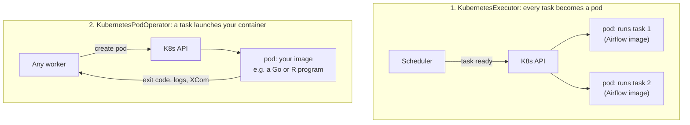
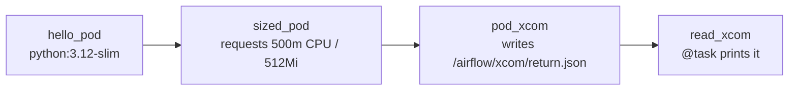

# 15 · Airflow + Kubernetes

---

## Part 1 — Containers and Kubernetes in one page

**Docker / containers**: package an application with all its code, libraries and dependencies into an **image**. Run it anywhere a container runtime exists, with the same result. Moving code between machines stops breaking because of "it needs library X version Y".

**Kubernetes**: an open source **container orchestration** platform. With many containers (invoices, payments, notifications...) that must talk to each other, scale and survive failures, doing it by hand is tedious. Kubernetes:
- schedules containers (in **pods**) across many machines
- restarts / replaces them when they fail
- scales them up and down with demand
- load-balances traffic, keeps storage attached

Airflow orchestrates **tasks**; Kubernetes orchestrates **containers**. They combine in two separate ways.

---

## Part 2 — Two integrations (don't confuse them)



| | KubernetesExecutor | KubernetesPodOperator |
|---|---|---|
| Is a... | executor (how **all** tasks run) | operator (what **one** task does) |
| Pod runs | Airflow itself, executing your task | **any** image you choose |
| Configured in | `airflow.cfg` / Helm values | the DAG |
| Solves | elastic workers, scale to zero, per-task resources | dependency isolation, non-Python workloads, heavy jobs |
| Works with Celery executor | (CeleryKubernetesExecutor / multi-executor) | yes, any executor |

### KubernetesExecutor

- Scheduler asks the Kubernetes API for **one pod per task instance**; the pod runs the task and exits.
- No idle workers: pay for pods only while tasks run.
- Per-task resources with `executor_config={"pod_override": k8s.V1Pod(...)}`.
- Pod startup adds seconds of latency per task; fine for long tasks, wasteful for thousands of tiny ones.

### KubernetesPodOperator

The most useful one in practice, including on Composer: run a container image as a task.

```python
from airflow.providers.cncf.kubernetes.operators.pod import KubernetesPodOperator

KubernetesPodOperator(
    task_id="run_container",
    name="run-container",
    image="python:3.12-slim",
    cmds=["python", "-c"],
    arguments=["print('hello from a pod')"],
)
```

Why: the task's libraries (TensorFlow, a Java tool, a specific pandas version) never conflict with Airflow's own dependencies, and you control CPU / memory per task.

---

## Part 3 — On Cloud Composer

- Composer itself **runs on GKE**: scheduler, workers, triggerer are pods. In Composer 2/3 workers autoscale.
- `KubernetesPodOperator` in Composer 3 launches pods in the environment's cluster (namespace `composer-user-workloads`) using the environment's service account by default. Composer 2 used the environment cluster too; for heavy jobs use `GKEStartPodOperator` to target a separate GKE cluster you control.
- [`k8s_pod_dag.py`](k8s_pod_dag.py): one pod with a public image, one with resource requests, and an XCom returned from the pod.



Pod XCom: with `do_xcom_push=True`, the operator adds a sidecar; whatever the container writes to `/airflow/xcom/return.json` becomes the task's return value.

Locally, the DAG needs a cluster (kind / minikube) and `apache-airflow-providers-cncf-kubernetes`; set `in_cluster=False` and a `config_file` / `kubernetes_conn_id`.

---

## Cheat sheet

```python
KubernetesPodOperator(
    task_id="t", name="t", image="img:tag",
    cmds=[...], arguments=[...], env_vars={"K": "V"},
    container_resources=k8s.V1ResourceRequirements(requests={"cpu": "500m", "memory": "512Mi"}),
    get_logs=True, do_xcom_push=False, on_finish_action="delete_pod",
)
```

```ini
[core]
executor = KubernetesExecutor
```
