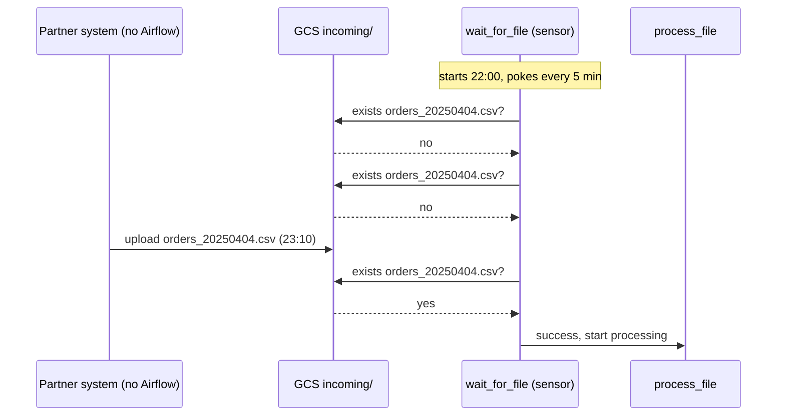

# 16 · Sensors

---

## Part 1 — What a sensor is

A **sensor** is an operator that **waits** for something to be true, then succeeds so downstream tasks can start:
- a file lands in a folder / bucket
- a row appears in a table, a partition exists
- another DAG's task finished
- an HTTP endpoint returns OK
- a point in time is reached

It checks (pokes) every `poke_interval` seconds until the condition is met or `timeout` expires (then it fails, or skips with `soft_fail=True`).

### "Why not just a dependency?"

Inside one Airflow, if `t2` needs `t1`'s output, write `t1 >> t2`. No sensor needed.

Sensors are for things **you don't control**: another company, another team, a system without Airflow.



Example: a supplier sends purchase orders as a file "some time between 22:00 and midnight". Scheduling processing at a fixed 22:00 fails whenever the file is late. A sensor waits for it, then processing starts immediately.

---

## Part 2 — Modes: poke, reschedule, deferrable

A waiting sensor can waste a worker slot for hours. Three modes:

| Mode | While waiting | Use for |
|---|---|---|
| `mode="poke"` (default) | holds a worker slot, sleeps between checks | short waits (seconds / few minutes) |
| `mode="reschedule"` | releases the slot between checks; task shows `up_for_reschedule` | long waits, intervals of minutes |
| `deferrable=True` | hands the wait to the **triggerer** (async, thousands of waits on one process); no worker slot at all | long waits, the best option when the sensor supports it |

> **Tip:** Always set `timeout` (default is 7 days!) and a sensible `poke_interval`. A sensor that pokes GCS every second for a week is both expensive and noisy.

---

## Part 3 — Common sensors

| Sensor | Package | Waits for |
|---|---|---|
| `FileSensor` | `providers.standard.sensors.filesystem` | a local file / glob (uses a `fs` connection, default `fs_default`) |
| `GCSObjectExistenceSensor` | `providers.google.cloud.sensors.gcs` | an object in a bucket |
| `GCSObjectsWithPrefixExistenceSensor` | same | any object with a prefix |
| `BigQueryTableExistenceSensor` / `...PartitionExistenceSensor` | `providers.google.cloud.sensors.bigquery` | a table / partition |
| `ExternalTaskSensor` | `providers.standard.sensors.external_task` | a task in another DAG |
| `HttpSensor` | `providers.http.sensors.http` | an endpoint condition |
| `TimeDeltaSensor`, `DateTimeSensor` | `providers.standard.sensors.time_delta` / `date_time` | a moment in time |
| `PythonSensor` / `@task.sensor` | standard | your function returns `True` |

### Examples

[`file_sensor_dag.py`](file_sensor_dag.py) (runs locally): waits for `/tmp/airflow-incoming/orders_<ds_nodash>.csv`, then counts its lines.

```bash
airflow connections get fs_default || airflow connections add fs_default --conn-type fs --conn-extra '{"path": "/"}'
airflow dags test file_sensor_dag 2025-04-04 &
sleep 20
mkdir -p /tmp/airflow-incoming && printf 'id\n1\n2\n' > /tmp/airflow-incoming/orders_20250404.csv
```

[`gcs_sensor_dag.py`](gcs_sensor_dag.py) (Composer): waits **deferrably** for `data/incoming/orders_<ds_nodash>.csv` in the environment bucket, then loads it into BigQuery.

```bash
upload_dag 16-sensors/gcs_sensor_dag.py
airflow_cli dags trigger gcs_sensor_dag
# later
gcloud storage cp 10-bigquery-pipeline/data/products.csv gs://<bucket>/data/incoming/orders_$(date -u +%Y%m%d).csv
```

`@task.sensor` for custom conditions:

```python
from airflow.sdk import PokeReturnValue, task

@task.sensor(poke_interval=60, timeout=3600, mode="reschedule")
def api_ready() -> PokeReturnValue:
    ok = check_something()
    return PokeReturnValue(is_done=ok, xcom_value={"checked": True})
```

---

## Cheat sheet

```python
FileSensor(task_id="w", filepath="/path/f.csv", poke_interval=30, timeout=3600, mode="reschedule")
GCSObjectExistenceSensor(task_id="w", bucket=B, object="path/f.csv", deferrable=True, timeout=6*3600)
ExternalTaskSensor(task_id="w", external_dag_id="other", external_task_id="final", mode="reschedule")
```
