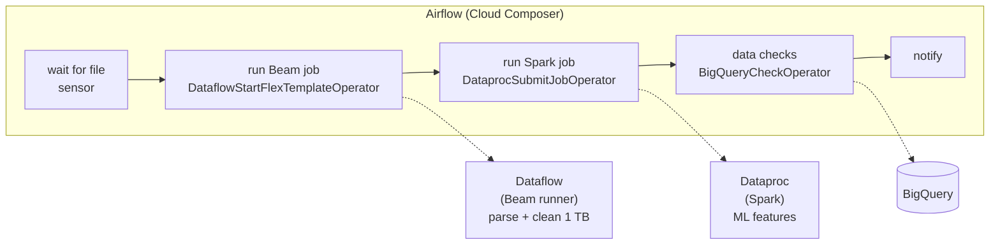

# 17 · Airflow vs Beam vs Spark

Three Apache projects that show up in the same conversations and get confused. The short version: **Airflow decides *when* and *in what order* things run; Beam and Spark *are* the things that crunch the data.**

---

## Part 1 — One line each

| | Apache Airflow | Apache Beam | Apache Spark |
|---|---|---|---|
| Category | **workflow orchestrator** | **unified programming model** for batch + streaming pipelines | **distributed processing engine** |
| You write | DAGs: tasks + dependencies + schedule | a pipeline of transforms (`PCollection`s) | jobs on DataFrames / RDDs / SQL |
| Moves the data itself? | no (it tells other systems to) | yes (via a runner) | yes |
| Runs on | its own scheduler + workers | a **runner**: Dataflow, Flink, Spark, Direct | its own cluster (standalone, YARN, K8s), Dataproc, Databricks |
| Streaming | no (batch-scheduled, event-triggered) | yes, first-class (windows, watermarks) | yes (Structured Streaming) |
| GCP managed | **Cloud Composer** | **Dataflow** | **Dataproc** / Dataproc Serverless |
| Languages | Python | Java, Python, Go, (SQL) | Scala, Java, Python, R, SQL |

---

## Part 2 — How they fit together

They're not competitors; a typical GCP pipeline uses Airflow **on top of** the others:



- Airflow: scheduling, dependencies, retries, alerts, history, branching. The work inside each task is "submit a job and wait".
- Beam / Spark: the heavy transformation of large data, in parallel across many machines.

> **Warning:** Don't process big data **inside** Airflow workers (e.g. loading 10 GB into pandas in a `@task`). Workers are sized for orchestration. Push the heavy lifting to BigQuery, Dataflow, Dataproc or a pod.

---

## Part 3 — Beam vs Spark (the confusing pair)

- **Beam** is a *model + SDK*: write once, run on several engines. Its strength is a consistent model for batch and streaming (event time, windows, late data). On GCP it means **Dataflow**, fully serverless, autoscaling.
- **Spark** is an *engine*: very fast in-memory processing, huge ecosystem (Spark SQL, MLlib, GraphX), Hadoop-compatible. On GCP it means **Dataproc**.
- Spark can even be a **runner** for Beam.

Rough guide: streaming with complex event-time logic or "no cluster at all" -> Beam on Dataflow. Existing Spark / Hadoop code, notebooks, MLlib, interactive analysis -> Spark on Dataproc. Mostly SQL -> just BigQuery.

---

## Cheat sheet

```text
Airflow = when / in what order / what if it fails   (Composer)
Beam    = how to transform data, batch + streaming  (Dataflow)
Spark   = fast distributed compute engine           (Dataproc)
```
