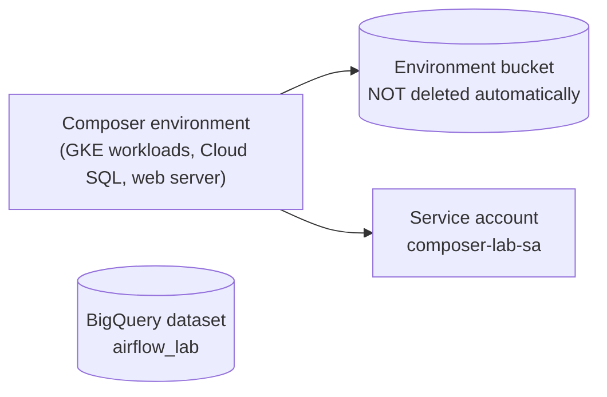

# 19 · Composer cleanup

A Composer environment costs money **every hour it exists**, idle or not. When you finish a study session, delete it.

---

## What to delete



| Resource | Deleted with the environment? |
|---|---|
| GKE workloads, Cloud SQL DB, web server | yes |
| Environment **bucket** (DAGs, data, logs) | **no**: delete it yourself if you don't need it |
| BigQuery datasets / tables you created | no |
| Service accounts / IAM bindings | no |
| Disks / snapshots of saved environment state | no |

## Script

[`cleanup.sh`](cleanup.sh) deletes, in order: the environment, its bucket, the `airflow_lab` dataset, and the lab service account. It asks before each step.

```bash
source 03-composer-environment/scripts/env.sh
./19-composer-cleanup/cleanup.sh
```

> **Tip:** Want to keep your DAGs? They're in this repo. Recreating the environment ([03](../03-composer-environment/README.md)) and re-uploading takes about half an hour. Composer also has **save / load environment snapshots** if you need to keep Variables, Connections and state.

## Check nothing is left

```bash
gcloud composer environments list --locations $REGION
gcloud storage buckets list --filter="name~${ENV_NAME}"
bq ls
gcloud iam service-accounts list --filter="email~composer-lab"
```

Billing -> Reports, filtered by service "Cloud Composer", should flatten out within a day.
