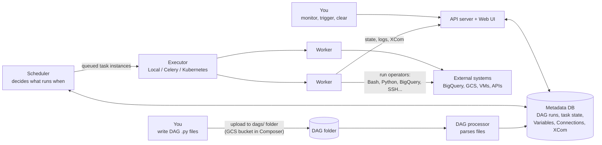

# Apache Airflow study notes

Notes covering Apache Airflow from the basics (pipelines, DAGs, operators, architecture) to running real pipelines on **Google Cloud Composer** (managed Airflow on GCP), including BigQuery, XCom, branching, task groups, sensors and Kubernetes.
Each folder has a `README.md` with explanations and a cheat sheet; most include runnable DAGs or scripts.

All code targets **Airflow 3.x** (and Composer 3). Where older Airflow 1.x / 2.x syntax is still common in tutorials, the notes point out the difference.

## Index

| # | Folder |
|---|---|
| 00 | [Data pipelines, tasks & orchestration](00-intro-pipelines-orchestration/README.md) |
| 01 | [DAGs & operators](01-dags-operators/README.md) |
| 02 | [Architecture: scheduler, workers, executors, single vs multi-node](02-architecture/README.md) |
| 03 | [Cloud Composer: provisioning an environment](03-composer-environment/README.md) |
| 04 | [Web UI & Composer buckets](04-web-ui-navigation/README.md) |
| 05 | [DAG file structure + first DAG](05-dag-structure/README.md) |
| 06 | [Templating (Jinja, macros, params) & dependencies](06-templating/README.md) |
| 07 | [Variables](07-variables/README.md) |
| 08 | [Calling Bash scripts (other folder / other machine)](08-bash-scripts/README.md) |
| 09 | [Connections](09-connections/README.md) |
| 10 | [BigQuery pipeline](10-bigquery-pipeline/README.md) |
| 11 | [XCom: passing data between tasks](11-xcom/README.md) |
| 12 | [Branching](12-branching/README.md) |
| 13 | [TaskGroups (and the old SubDAGs)](13-taskgroups-subdags/README.md) |
| 14 | [SLAs, timeouts & alerting](14-sla-deadlines/README.md) |
| 15 | [Airflow + Kubernetes](15-kubernetes/README.md) |
| 16 | [Sensors](16-sensors/README.md) |
| 17 | [Airflow vs Beam vs Spark](17-airflow-vs-beam-spark/README.md) |
| 18 | [Review questions](18-review-questions/README.md) |
| 19 | [Composer cleanup](19-composer-cleanup/README.md) |

## The big picture



Each concept solves a problem of the one before it:
1. **cron** runs scripts on a timer, but knows nothing about dependencies, retries or history.
2. **Task** = one unit of work (a Bash command, Python function, SQL query...).
3. **DAG** = tasks + dependencies + schedule, so tasks only run when their upstream tasks succeeded.
4. **Operators / sensors** = reusable templates for tasks (run Bash, query BigQuery, wait for a file).
5. **Variables / Connections** = configuration and credentials kept out of the code.
6. **XCom, branching, task groups** = tasks that talk to each other, choose paths, and are organised visually.

## Things that changed in recent Airflow versions

| Old (1.x / early 2.x) | Now (Airflow 3.x) |
|---|---|
| `from airflow import DAG`, `from airflow.models import Variable` | `from airflow.sdk import DAG, Variable, task, TaskGroup` |
| `from airflow.operators.bash_operator import BashOperator` | `from airflow.providers.standard.operators.bash import BashOperator` |
| `DummyOperator` | `EmptyOperator` |
| `schedule_interval=timedelta(days=1)` | `schedule="@daily"` (or cron, timedelta, Asset, Timetable) |
| `catchup=True` by default (backfills every missed interval) | `catchup=False` by default |
| `execution_date` | `logical_date` (`{{ ds }}` still works) |
| `provide_context=True` on PythonOperator | removed: context is passed automatically |
| `BigQueryOperator` (contrib) | `BigQueryInsertJobOperator` (Google provider) |
| `SubDagOperator` | removed: use `TaskGroup` |
| `sla=` / `sla_miss_callback` | removed in 3.0; use `execution_timeout`, callbacks, or Deadline Alerts (3.1+) |
| Web server talks to the DB; workers talk to the DB | API server; workers talk to the API (Task Execution Interface), not the DB directly |
| Composer 1 (fixed nodes, min 3) | Composer 3 (GKE Autopilot under the hood, scales workers automatically) |
| Key-file JSON in connections | Environment service account / impersonation, no key files |

## Local setup (no cloud needed)

Most DAGs here (everything except BigQuery/GCS) run on a laptop:

```bash
uv venv --python 3.12 && source .venv/bin/activate
AIRFLOW_VERSION=3.1.0
PY=3.12
uv pip install "apache-airflow==${AIRFLOW_VERSION}" \
  --constraint "https://raw.githubusercontent.com/apache/airflow/constraints-${AIRFLOW_VERSION}/constraints-${PY}.txt"

export AIRFLOW_HOME=$PWD/.airflow
export AIRFLOW__CORE__DAGS_FOLDER=$PWD          # Airflow scans folders recursively
export AIRFLOW__CORE__LOAD_EXAMPLES=False
airflow standalone                              # DB + scheduler + API server, prints admin password
# UI: http://localhost:8080
```

Useful while learning:

```bash
airflow dags list
airflow dags list-import-errors
airflow dags test <dag_id> 2025-01-01      # run a whole DAG once, in-process, no scheduler needed
airflow tasks test <dag_id> <task_id> 2025-01-01
```

For the GCP examples install the provider too: `uv pip install apache-airflow-providers-google` (already included in Composer).
